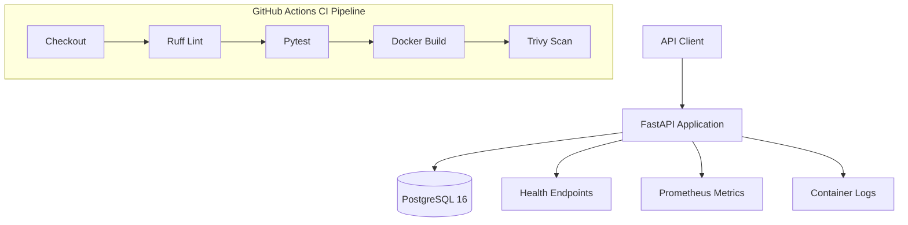

# Apex Operations API

A containerized REST API built with **FastAPI and PostgreSQL**, demonstrating application development, Docker containerization, automated testing, CI quality gates, vulnerability scanning, health checks, monitoring instrumentation, and versioned release rollback.

This project was developed as part of a Junior DevOps Engineer practical assessment.

## 1. Architecture

### System Overview



### Technology Stack

| Component | Technology |
|---|---|
| Backend API | Python, FastAPI |
| Application Server | Uvicorn |
| Database | PostgreSQL 16 |
| ORM | SQLAlchemy |
| Containerization | Docker |
| Orchestration | Docker Compose |
| Automated Testing | Pytest |
| Code Quality | Ruff |
| CI/CD | GitHub Actions |
| Vulnerability Scanning | Trivy |
| Metrics | Prometheus Client |

## 2. Project Structure

```text
apex-operations-api/
├── app/
│   ├── main.py
│   └── ...
├── tests/
│   ├── conftest.py
│   ├── test_health.py
│   ├── test_tasks.py
│   └── test_metrics.py
├── .github/
│   └── workflows/
│       └── ci.yml
├── Dockerfile
├── compose.yaml
├── requirements.txt
├── requirements-dev.txt
├── pyproject.toml
├── .env.example
├── .gitignore
└── RUNBOOK.md
```

## 3. Prerequisites

- Docker Desktop
- Docker Compose v2
- Git
- Python 3.12 (for local development)

## 4. Getting Started

### Clone the Repository

```bash
git clone https://github.com/HindAljuaid/apex-operations-api.git
cd apex-operations-api
```

### Configure Environment Variables

Create the local environment file:

```bash
cp .env.example .env
```

Review `.env` and configure the PostgreSQL database credentials.

The `.env` file contains local development settings and must not be committed to Git.

### Build the Docker Image

Build the initial application image:

```bash
docker build -t apex-operations-api:1.0.0 .
```

### Start the Application

Select the image version and start the services:

```bash
export APP_VERSION=1.0.0
docker compose up -d
```

Docker Compose starts the API and PostgreSQL services. The API waits for the database health check before starting.

### Verify the Containers

```bash
docker compose ps
```

Both services should report healthy status.

## 5. API Endpoints

The API provides the following endpoints:

| Method | Endpoint | Description |
|---|---|---|
| GET | `/` | Application information and version |
| GET | `/health/live` | Application liveness check |
| GET | `/health/ready` | Application readiness check |
| GET | `/tasks` | Retrieve tasks |
| GET | `/tasks/{id}` | Retrieve a task by ID |
| POST | `/tasks` | Create a task |
| PATCH | `/tasks/{id}` | Update a task |
| DELETE | `/tasks/{id}` | Delete a task |
| GET | `/metrics` | Prometheus-format application metrics |

Interactive API documentation:

`http://localhost:8000/docs`

### Health Check Examples

Check liveness:

```bash
curl http://localhost:8000/health/live
```

Check readiness:

```bash
curl http://localhost:8000/health/ready
```

Check application information:

```bash
curl http://localhost:8000/
```

## 6. Local Development

Create and activate a Python virtual environment:

```bash
python3 -m venv .venv
source .venv/bin/activate
```

Install development dependencies:

```bash
pip install -r requirements-dev.txt
```

Run the linter:

```bash
ruff check app/ tests/
```

Run automated tests:

```bash
python -m pytest -v
```

The automated test suite covers health endpoints, task operations, and application metrics.

## 7. CI Pipeline

GitHub Actions automatically runs the CI workflow when code is pushed to `main` or a pull request targets `main`.

### Pipeline Stages

1. **Checkout:** Retrieves the repository source code.
2. **Lint:** Runs Ruff to identify code quality issues.
3. **Test:** Runs the automated Pytest suite.
4. **Docker Build:** Builds the application image only after the quality job succeeds.
5. **Security Scan:** Runs Trivy against the built image.

The Docker build job depends on the successful completion of the quality job. Therefore, a failed lint or test stage prevents the Docker build and security scan from running.

### CI Workflow

`.github/workflows/ci.yml`

GitHub Actions results:

https://github.com/HindAljuaid/apex-operations-api/actions/workflows/ci.yml

An intentional failing test was also used to verify that the pipeline blocks subsequent jobs when the quality stage fails.

## 8. Container Security

The Docker image includes the following security measures:

- Runs the application as a non-root user.
- Uses a Python slim base image.
- Removes pip and its bundled packages from the final runtime image after installing application dependencies.
- Keeps database credentials in environment variables rather than source code.
- Does not expose the PostgreSQL port to the host.
- Uses Trivy to scan image vulnerabilities.

### Vulnerability Scanning

Scan the local image:

```bash
trivy image --scanners vuln --severity HIGH,CRITICAL apex-operations-api:1.0.3
```

Scan only vulnerabilities with available fixes:

```bash
trivy image --ignore-unfixed --severity HIGH,CRITICAL apex-operations-api:1.0.3
```

The assessment scan identified unresolved HIGH-severity operating-system findings without available fixes. The scan with `--ignore-unfixed` reported no HIGH or CRITICAL findings with available fixes.

These results should not be interpreted as proof that the image has zero vulnerabilities.

## 9. Monitoring and Observability

The API exposes Prometheus-format metrics through:

`http://localhost:8000/metrics`

Implemented metrics:

- `apex_http_requests_total`: Counts HTTP requests.
- `apex_http_request_duration_seconds`: Measures HTTP request duration.

Docker Compose also provides container health checks, and application and database logs can be inspected using:

```bash
docker compose logs --tail=100 api
docker compose logs --tail=100 db
```

A Prometheus server, Grafana dashboard, and active alerting system are not included in the current implementation. Suggested monitoring rules and investigation procedures are documented in `RUNBOOK.md`.

## 10. Versioned Releases and Rollback

The application image uses version tags to support release selection and rollback.

For example, to run version `1.0.3`:

```bash
export APP_VERSION=1.0.3
docker compose up -d
```

Verify the running application version:

```bash
curl http://localhost:8000/
```

To roll back to version `1.0.0`:

```bash
export APP_VERSION=1.0.0
docker compose up -d
```

The assessment demonstrates local image-based rollback. Database schema migrations are not automatically reversed.

## 11. Data Persistence

PostgreSQL uses a named Docker volume to preserve database data across container restarts and ordinary Compose shutdowns.

Stop the services without deleting persistent data:

```bash
docker compose down
```

Avoid `docker compose down -v` unless intentionally deleting the database volume.

## 12. Operational Documentation

For deployment instructions, health checks, troubleshooting, log inspection, metrics, security notes, and rollback procedures, see:

**[RUNBOOK.md](RUNBOOK.md)**

## 13. Current Scope and Limitations

The project demonstrates a local containerized deployment and a GitHub Actions CI pipeline.

The following capabilities are not currently implemented:

- Production cloud deployment.
- Automated continuous deployment to a cloud environment.
- Prometheus server or Grafana dashboard.
- Configured production alerting.
- Automated database migrations using Alembic.
- Automated database backup and restore.

These are potential improvements for a production-ready implementation.

## 14. AI Assistance Disclosure

AI assistance was used during development for technical explanations, troubleshooting, reviewing implementation approaches, and drafting documentation.

All commands and implementation changes were reviewed and executed in the development environment. Automated tests, container health checks, CI runs, and security scans were used to validate the implementation.

## 15. Author

**GitHub:** [HindAljuaid](https://github.com/HindAljuaid)

**Project Repository:** [Apex Operations API](https://github.com/HindAljuaid/apex-operations-api)